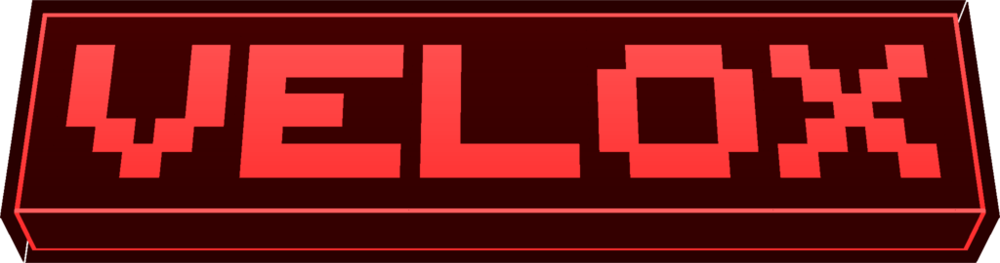

<p align="center">


</p>

> **Velox is built to take work off your server when lots of dropped items are lying around.** Big explosions, mob
> drops piling up, a storage room emptied onto the floor: instead of working out where each item goes one by one,
> Velox does them all in one go.

## ✨ Features

- 🎯 **Just like vanilla:** items fall, slide and get picked up exactly as in the normal game. Farms and
  contraptions keep working.
- 🖥️ **Server only:** players join with a normal game, nothing to install on their side. Also works in
  singleplayer.
- 🔌 **Nothing to set up:** add it and it works.
- 🔬 **Checked on every version:** each supported Minecraft version is tested tick by tick against vanilla, and every
  item has to end up in exactly the same spot.

> **You also need [Celeris](https://github.com/PanzerDevOrg/Celeris).** Put both in the server's `mods` folder
> (or in your own, for singleplayer).

## 💡 Good to know

- ✅ **Handled by Velox:** items falling through the air or lying on full blocks such as stone, dirt, grass or ice.
- ↩️ **Left to the normal game, while they are there:** items in water or lava, on hoppers, slabs, stairs or
  carpets, on slime, honey or soul sand, against fences or in cobwebs, or next to boats and minecarts.
- 📈 **How much it helps:** on a test server (Minecraft 1.21.1, 4 shared CPU cores) 50,000 items lying on the ground took
  about 70 ms per tick with Velox and 490 ms without; 500,000 took 1.1 s against 12 s, and 100,000 falling items
  235 ms against 1.6 s. The more crowded the items, the bigger the gain (3× spread far apart, up to 19× piled up).
  Velox does not remove everything Minecraft does per item: it keeps about 25,000 to 35,000 items inside a 50 ms tick,
  where the normal game manages roughly 5,000 to 9,000. Counts above the default `maxItemsPerLevel` (32,768) need
  that setting raised. Methods and tables in [`docs/benchmarks.md`](./docs/benchmarks.md).
- ⚙️ **Settings** are in `config/velox-common.toml`: `enabled = false` turns Velox off (after a restart), and
  `maxItemsPerLevel` (default 32,768) is how many items per dimension it handles.
- 📦 **Minecraft** 1.21 – 1.21.11 and 26.1 – 26.3, on NeoForge. Download the file made for your version.

<p align="center">
<a href="https://github.com/PanzerDevOrg/Celeris"></a>
</p>

## 📊 Benchmarks


<!-- publish:off -->

## Files per version

| Minecraft | File |
|---|---|
| 1.21 – 1.21.6 | `velox-<version>+1.21.1.jar` |
| 1.21.7 – 1.21.10 | `velox-<version>+1.21.10.jar` |
| 1.21.11 | `velox-<version>+1.21.11.jar` |
| 26.1 – 26.3 | `velox-<version>+26.1.jar` |

Every version listed is checked against vanilla, tick by tick: each file runs a dedicated server on every version
it covers and must move every item exactly as vanilla does.

## JVM flags (optional)

Velox works without any setup. It runs on Celeris's native physics kernel (AVX2, AVX-512 or NEON, picked for your
CPU) when it can, and on the pure-Java kernel otherwise:

| Minecraft (Java) | JVM arguments for the native kernel |
|---|---|
| 1.21.x (Java 21) | `--enable-preview` |
| 26.x (Java 25) | none |

Leave `--enable-native-access` out. It looks like the right flag for native code, but on Java 21 it makes the JVM
refuse native calls from every module it does not list, and NeoForge loads mods as named modules that the flag
(`ALL-UNNAMED`) cannot cover. The native kernel is then blocked and Celeris quietly uses its pure-Java kernel instead.
Nothing breaks and every item ends up in exactly the same place; only the native kernel's speed is lost, which in
our tests (100,000 items) made no measurable difference to the tick.
Velox logs which kernel it is using at startup, and what to change when it is not the native one.

## Configuration

`config/velox-common.toml`:

| Option | Default | Effect |
|---|---|---|
| `enabled` | `true` | Turn the batch physics on or off |
| `maxItemsPerLevel` | `32768` | Items simulated per dimension; the rest keep vanilla physics |
| `windowSections` | `48` | Width of the terrain snapshot around the items, in 16-block sections |
| `sectionFillsPerTick` | `256` | Chunk sections copied into the snapshot per tick |

## How it works

Once per tick, right before the level ticks its entities, every item in the dimension is stepped in one Celeris
batch. Each item then applies its result at the exact point of its own tick where vanilla would have run
`applyGravity()` / `move()` / friction; the rest of `ItemEntity.tick` runs unchanged. Velox contains no simulation
code of its own: it only connects Minecraft to Celeris.

| Piece | Role |
|---|---|
| `ServerLevelMixin` | Runs the batch right before the level ticks its entities (after block and fluid ticks) |
| `ItemEntityMixin` | Replaces the physics block of `ItemEntity.tick` with the batch result, only when it was simulated |
| `EntityMixin` | Notices outside writes (teleports, knockback, commands) and re-reads those items next tick |
| `LevelChunkMixin` | Keeps the terrain snapshot current on every block change |
| `ItemPhysicsWorld` | Per-dimension Celeris batch, terrain window and bridge |
| `BlockClassifier` | Block state to air / full cube (by friction) / complex |
| `TerrainSampler` | Copies loaded chunk sections into the snapshot, never loads chunks |

Anything the engine does not model exactly (fluids, partial or special blocks, boats/shulkers/minecarts, the world
border, unloaded chunks) makes that item run vanilla code for that tick. Only plain `ItemEntity` instances with
normal gravity are simulated; subclasses from other mods are left alone.

Every supported version is checked in CI by `./gradlew parity`: a headless server runs Velox and vanilla side by side
on the same course (ice, slime, soul sand, honey, slabs, fences, cobwebs, walls placed and floors removed under
items...) and compares every item, every tick, bit for bit. It also covers stacks that merge, items that despawn or are
removed, a chunk that unloads and loads again with its items, and more items than the batch holds. Each version is
claimed only after its check passes.

## Building

Clone [PanzerBuildLogic](https://github.com/PanzerDevOrg/PanzerBuildLogic) next to Velox as `panzer-build-logic`.
Velox resolves Celeris from `mavenLocal()` first (to try an unreleased Celeris, `./gradlew publishToMavenLocal` in
it), then from Celeris's GitHub Pages Maven repository:

```bash
git clone https://github.com/PanzerDevOrg/PanzerBuildLogic.git panzer-build-logic
cd Velox && ./gradlew buildAndCollect
```

## Releasing

This README is also the description on Modrinth and CurseForge (everything outside `publish:off` blocks). Add
`docs/changelogs/<version>.md`, set `version` under `[mod]`, then tag `v<version>`. CI publishes through
panzer-build-logic's shared publisher; every other push uploads a `release-preview` artifact with the pages and files
as they would be published. Every release on GitHub carries each jar with its `-sources.jar` (the AGPL source for
that file) and `SHA256SUMS.txt`.

While Velox is not public on Modrinth and CurseForge, `modrinth_id` and `curseforge_id` are commented out under
`[publish]` in `mod.stonecutter.properties.toml`: the publisher skips a site without a project id, so a tag publishes
only to GitHub and needs no tokens. To publish there too, uncomment both ids, set `MODRINTH_TOKEN` and
`CURSEFORGE_TOKEN` as secrets of this repository (a private repository does not get the organization's), and run the
CI on the tag (dry run off, `targets` = the site).

<!-- panzer:license -->
## License

| Content | License |
|---|---|
| Source code | [AGPL-3.0](https://www.gnu.org/licenses/agpl-3.0.html), see [`LICENSE-AGPL`](./LICENSE-AGPL) |
| Artwork, branding and documentation | [CC BY-NC-SA 4.0](https://creativecommons.org/licenses/by-nc-sa/4.0/), see [`LICENSE-CC`](./LICENSE-CC) |

**Source code:** you may study, modify and redistribute it under the AGPL; if you run a modified version as a network service, its source must be available to that service's users.

**Artwork:** credit Panzer, no commercial use without permission, and share derivatives under the same license.

See [`LICENSE`](./LICENSE) for the full summary.
<!-- /panzer:license -->

<!-- publish:on -->

---

<!-- panzer:footer -->
Code: **AGPL-3.0** · Art: **CC BY-NC-SA 4.0** · Made by **Panzer**
<!-- /panzer:footer -->
