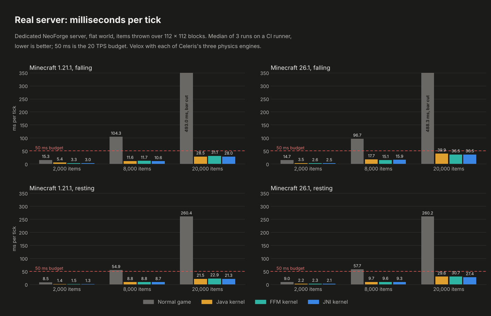
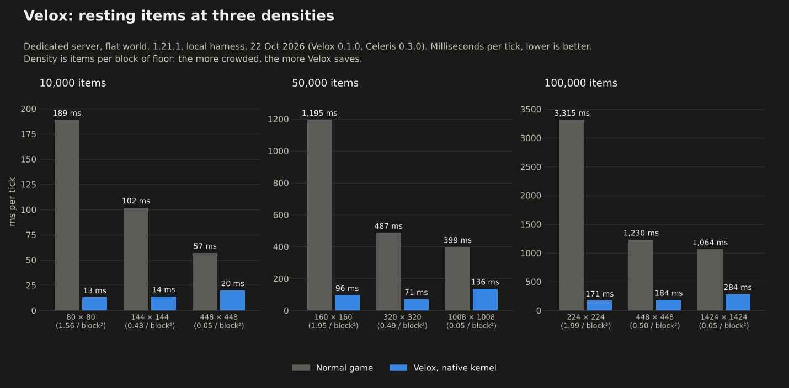
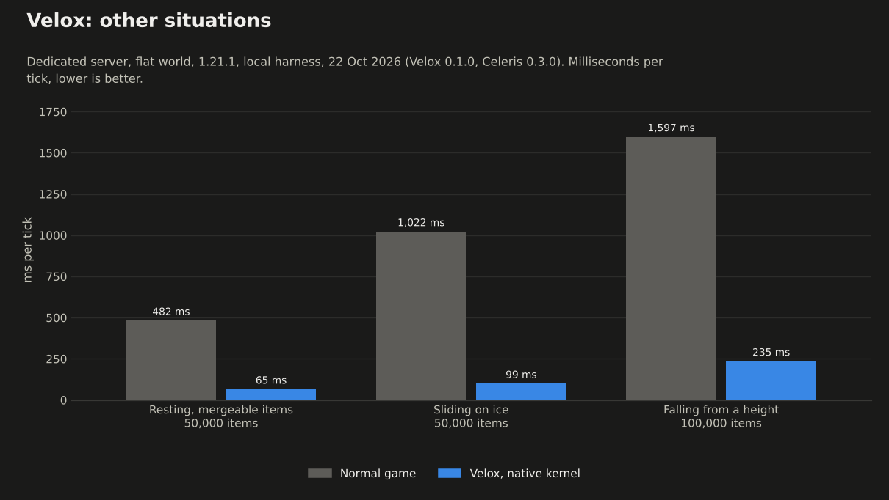

# Velox benchmarks

How long a server tick takes with lots of dropped items, with Velox and without it, up to a million items.

## Latest CI runs (30 October 2026): Java, JNI and FFM kernels

**Measured:** GitHub Actions runner (4 vCPU), Minecraft 1.21.1 (NeoForge 21.1.248, Java 21) and 26.1 (Java 25),
`bichal/BichalBuildLogic` `perf-test` run three times: runs 41010985422, 41010988292 and 41010991425; Celeris `6adf83b`,
Velox `main`. Median of the three runs. Falling is the first 80 ticks after the throw; resting is 1,200 ticks later.
The test runs Velox on each of Celeris's three physics engines (`-Dceleris.physics.engine=java|jni|ffm`; the log line
`Velox: items simulated by Celeris (...)` of every run confirms the engine). FFM needs `--enable-preview` on Java 21.

Falling / resting, ms per tick:

| Minecraft | Items | Normal game | Velox, Java kernel | Velox, FFM kernel | Velox, JNI kernel |
|---|---|---|---|---|---|
| 1.21.1 | 2,000 | 15.30 / 8.50 | 5.42 / 1.40 | 3.32 / 1.50 | 2.96 / 1.30 |
| 1.21.1 | 8,000 | 104.34 / 54.85 | 11.57 / 8.76 | 11.70 / 8.85 | 10.62 / 8.66 |
| 1.21.1 | 20,000 | 492.99 / 260.40 | 28.53 / 21.54 | 31.15 / 22.94 | 28.00 / 21.29 |
| 26.1 | 2,000 | 14.70 / 9.01 | 3.47 / 2.23 | 2.65 / 2.32 | 2.45 / 2.15 |
| 26.1 | 8,000 | 96.73 / 57.71 | 17.72 / 9.71 | 15.06 / 9.64 | 15.86 / 9.31 |
| 26.1 | 20,000 | 488.27 / 260.24 | 39.87 / 29.65 | 36.45 / 30.74 | 36.52 / 27.39 |

Velox is 5× to 18× faster than the normal game; the normal game moves a lot between runs (20,000 falling items on
1.21.1: 469–574 ms in these runs, 223–283 ms in three runs earlier the same day), so the factor is good to about 20 %.
**The three engines tie:** at 8,000 and 20,000 items they lie inside each other's range, and at 2,000 items falling
the Java kernel is slower (5.4 ms against 3.0–3.3 ms on 1.21.1; Java compiles the kernel while the test runs). In the
JFR profile of 1.21.1 the whole Celeris physics step is 1.0–1.5 % of the server thread with JNI, 1.6–2.0 % with FFM
and 7.0–7.9 % with the Java kernel (`collideBody` alone 5.6–6.1 %), so the most a native kernel can save is inside the
noise. Three runs earlier the same day (Java and JNI only, runs 41008058250, 41008080832, 41008083510) agree.

## Earlier CI run (29 October 2026)

**Measured:** GitHub Actions runner (4 vCPU), Minecraft 1.21.1, NeoForge 21.1.248, Java 21, `bichal/BichalBuildLogic`
`perf-test`, run 40949675630 (Celeris 0.3.1.1, `f6a6676`) and run 40949679932 (Celeris 3c1df34, current `main`), Velox
`main`. One run per cell. Falling is the first 80 ticks after the throw; resting is 1,200 ticks later.

| Items | Phase | Normal game | Velox, Java kernel | Velox, native kernel |
|---|---|---|---|---|
| 2,000 | Falling | 11.46 ms | 4.36 ms | 2.59 ms |
| 2,000 | Resting | 7.55 ms | 1.34 ms | 1.20 ms |
| 8,000 | Falling | 97.71 ms | 11.34 ms | 9.02 ms |
| 8,000 | Resting | 53.72 ms | 8.98 ms | 7.46 ms |
| 20,000 | Falling | 508.50 ms | 30.28 ms | 31.38 ms |
| 20,000 | Resting | 246.59 ms | 22.12 ms | 21.62 ms |

Celeris 0.3.1.1 and 3c1df34 with the native kernel (run 13 against run 14): 2,000 falling 2.84 / 2.59 ms, 2,000 resting
1.26 / 1.20 ms, 8,000 falling 10.82 / 9.02 ms, 8,000 resting 5.87 / 7.46 ms, 20,000 falling 26.63 / 31.38 ms, 20,000
resting 18.96 / 21.62 ms. The normal game also moved by up to 20 % between the two runs (425.95 / 508.50 ms falling at
20,000). These differences are within the run-to-run noise, so the Celeris update is not a measured speed-up for Velox.

Death ticks (mobs killed in one tick, with and without their drops) are **not measured yet**: the first attempt timed
ticks that did not contain the kills (0.1–0.25 ms in every case), so its numbers are not reported.

## Earlier measurements: local harness, 22 October 2026

**Measured:** 2026-10-22, Velox 0.1.0 with Celeris 0.3.0 (native AVX2 kernel), Minecraft 1.21.1, NeoForge, OpenJDK 21
(`-Xmx12g`). **Machine:** 4 vCPU shared cloud VM, Linux. A shared VM is noisy: read differences under ~20 % as a tie.

## Method

- A dedicated NeoForge server (`runServer`) on a flat world, no players connected, the area force-loaded.
  Server tick time is measured around every tick (`ServerTickEvent.Pre` to `Post`), so it includes everything the
  server does in that tick, not only item physics.
- **Without Velox** is the same jar with `enabled = false`: its mixins are loaded but every item takes the vanilla
  path. It is not a build of Minecraft with no Velox in it at all.
- N cobblestone stacks of 64 (never merged, never picked up, never despawn) are spawned at random places in a square
  area. **Resting:** on the ground, 200 warm-up ticks (fewer for 250,000 items and up, where one tick takes seconds),
  then the mean of 300 ticks (100 ticks at 250,000; 40 at 500,000 with Velox and 30 without; 20 at 1,000,000 with
  Velox and 10 without).
  **Falling:** dropped from y = 300 and measured for the 60 ticks after the throw. **Ice:** the floor is packed ice
  and the items are thrown sideways. **Mergeable:** 50,000 single items of 1,000 different kinds, which vanilla
  checks for merge partners but never merges.
- **Settings used for Velox:** `maxItemsPerLevel = 1048576` (the default, 32,768, would leave the rest of a
  100,000-item run on vanilla physics) and `windowSections = 96` (the default, 48, covers 768 blocks and some of the
  areas here are larger). `sectionFillsPerTick` was 64 for every row except the last two falling rows; it is 256 by
  default now. Resting rows were at 100 % applied either way.
- Density is items per block of floor. Minecraft's own work per item grows with how many other items are close to
  it, so the same number of items costs very different amounts spread out or piled up. Both are shown.
- The baseline with one item and no Velox: 1.2 ms (160 × 160 blocks), 2.2 ms (448 × 448), 8.2 ms (1008 × 1008) and
  13.8 ms (1424 × 1424). That is the cost of ticking the force-loaded chunks and is part of every number below.
- Velox rows are the median of the runs made (range in brackets when there was more than one). The vanilla rows are
  one run, except 50,000 at 0.49/block² (three runs, 484–497 ms). One Velox run of 500,000 items was thrown away: the
  terrain snapshot was still filling (see below), so part of the items were still running vanilla.
- The harness (`benchmarks/`) is local and is not part of the repository. `applied` (items whose tick used the Velox
  result) was checked at the end of the later runs: 100 % for every resting run.

## Results (ms per tick, lower is better; 50 ms is the 20 TPS budget)

| Case | Items | Area (density) | Vanilla | Velox | Speed-up |
|---|---|---|---|---|---|
| resting | 10,000 | 80×80 (1.56/block²) | 189 | 13 (12–15, 2 runs) | 14.0× |
| resting | 10,000 | 144×144 (0.48/block²) | 102 | 14 (12–16, 2 runs) | 7.3× |
| resting | 10,000 | 448×448 (0.05/block²) | 57 | 20 (17–22, 2 runs) | 2.9× |
| resting | 50,000 | 160×160 (1.95/block²) | 1,195 | 96 (72–121, 2 runs) | 12.4× |
| resting | 50,000 | 320×320 (0.49/block²) | 487 (484–497, 3 runs) | 71 (68–136, 4 runs) | 6.8× |
| resting | 50,000 | 1008×1008 (0.05/block²) | 399 | 136 (107–166, 2 runs) | 2.9× |
| resting | 100,000 | 224×224 (1.99/block²) | 3,315 | 171 (158–184, 2 runs) | 19.4× |
| resting | 100,000 | 448×448 (0.50/block²) | 1,230 | 184 (181–190, 4 runs) | 6.7× |
| resting | 100,000 | 1424×1424 (0.05/block²) | 1,064 | 284 (283–284, 2 runs) | 3.8× |
| resting | 250,000 | 720×720 (0.48/block²) | 4,343 | 546 (534–558, 2 runs) | 7.9× |
| resting | 500,000 | 1008×1008 (0.49/block²) | 12,282 | 1,147 | 10.7× |
| resting | 1,000,000 | 1424×1424 (0.49/block²) | 25,495 | 2,827 | 9.0× |
| resting, mergeable | 50,000 | 320×320 (0.49/block²) | 482 | 65 | 7.4× |
| sliding on ice | 50,000 | 320×320 (0.49/block²) | 1,022 | 99 | 10.3× |
| falling | 100,000 | 448×448 (0.50/block²) | 1,597 | 787 with `sectionFillsPerTick = 64`, **235** with 256, 211 with 1024 | 2.0×, **6.8×**, 7.6× |

The two 100,000-item runs of 448×448 that are not plain Velox runs are included in its four: one ran under Java Flight
Recorder (184 ms) and one with Celeris's Java kernel instead of the native one (184 ms), so the Java kernel costs
nothing measurable here.

## What it shows

- **Velox is 3× to 19× faster, and the gap grows with how crowded the items are.** Vanilla's per-item cost climbs
  with density (about 5 µs per item spread out, 25 to 33 µs per item piled up at 2 per block²) because each item looks
  at the entities around it. Velox skips that and costs 1.3 to 3 µs per item whatever the density.
- **It does not make a million items playable.** 1,000,000 items take 2.8 s per tick with Velox (0.35 TPS) and 25 s
  without (0.04 TPS). Keeping 20 TPS (50 ms) takes about 25,000 to 35,000 items with Velox, against about 5,000 to
  9,000 in vanilla when spread out and fewer than 3,000 when piled up.
- **Where the time goes with Velox** (Java Flight Recorder, 100,000 resting items, server thread): Velox plus the
  Celeris kernel are about 7 % of the tick, and the kernel itself under 3 %. The rest is Minecraft's own work per
  entity that Velox does not replace: walking the entity list and firing the tick event, checking the chunk is
  ticking, the entity tracker, `updateFluidOnEyes`, mob-spawn counting. More worker threads or a faster kernel cannot
  help there; only skipping that per-item work would, and that is a different, riskier change.
- **Falling items need the terrain snapshot to be loaded ahead of them.** With the old default of 64 chunk sections
  copied per tick only 55 % of 100,000 items dropped over a 448 × 448 area were using Velox when the measure ended; the
  rest ran vanilla while their sections waited. The default is now 256 (idle cost is zero: it is a ceiling), which
  gives 98 % and 235 ms.
- **Not measured:** players connected (entity tracking and network cost), Minecraft 1.21.10, 1.21.11 and 26.x,
  several dimensions, real farms and contraptions, hoppers and pick-ups, other mods, a real GPU or a faster CPU.
  Items in water, on slabs, slime and the other cases the README lists run vanilla and gain nothing.

## Reproducing

`tools/` and `benchmarks/` are kept out of the repository. The harness is a single class that spawns the items and
times the ticks (`-Dvelox.bench=scenario=rest,n=100000,area=448,warm=200,measure=300`), run on `runServer` with
`enabled = true` or `false` in `config/velox-common.toml`.
